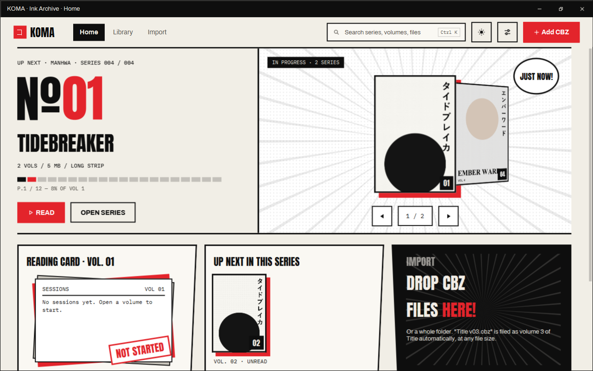
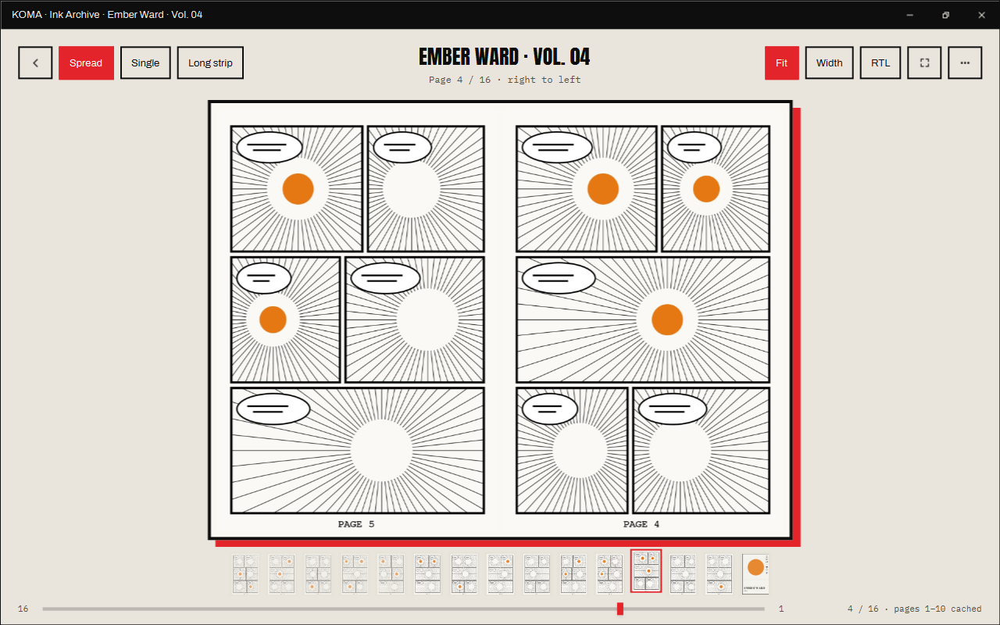
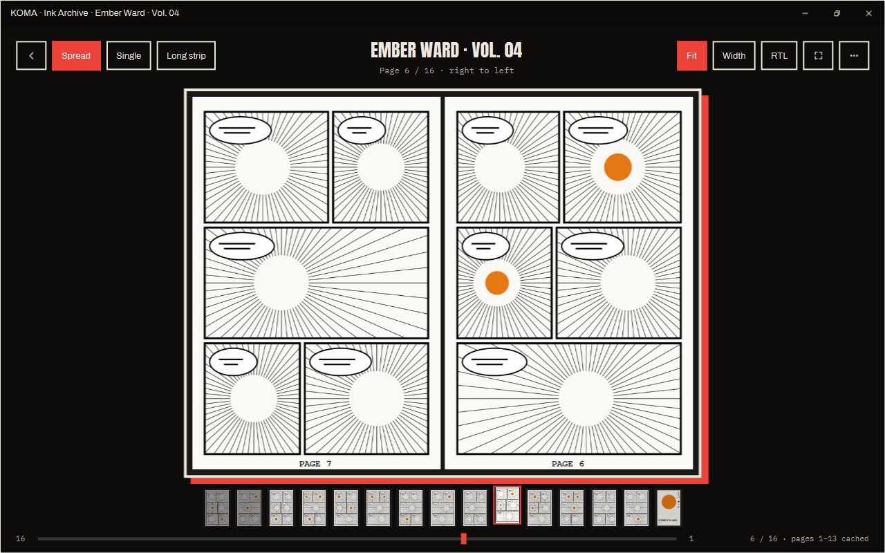
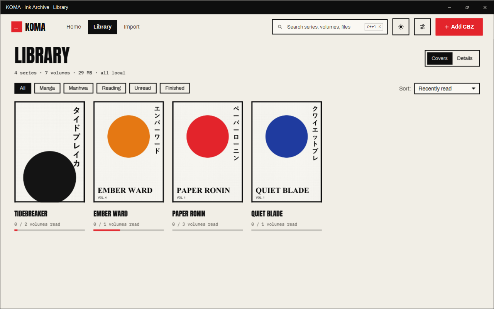
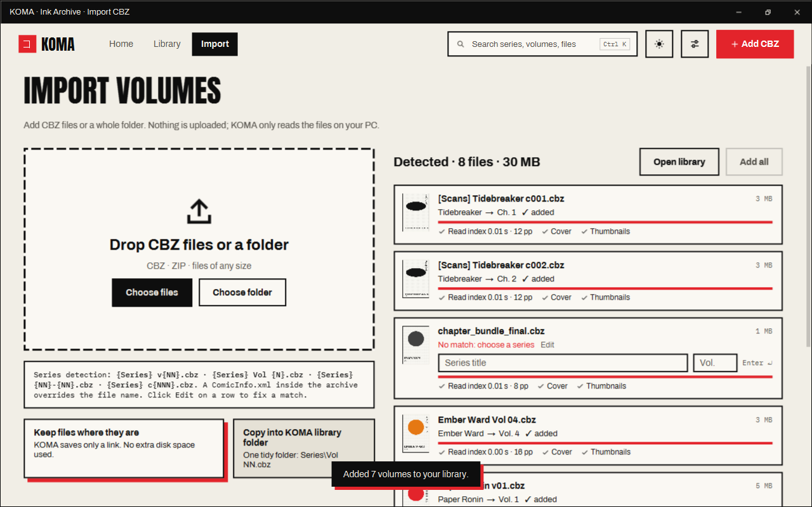
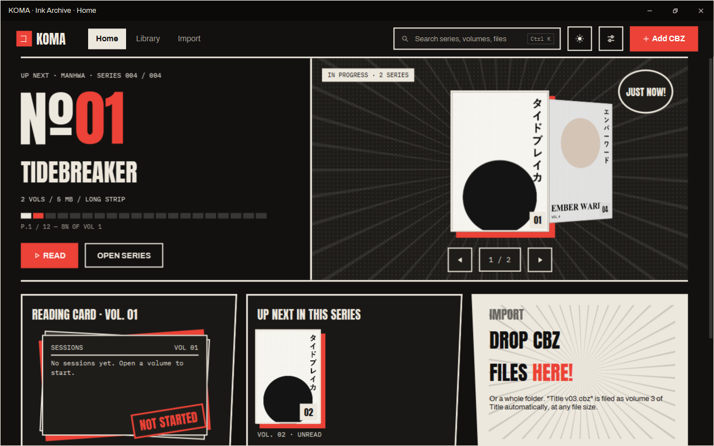

<div align="center">

# KOMA

**An offline manga & manhwa reader for Windows.**
Reads your local CBZ files in place, at any size, with no accounts and no internet.




</div>

## Features

- **Huge files, no waiting.** Multi-GB ZIP64 volumes open in milliseconds. KOMA reads only the archive index, then one page at a time; nothing is extracted to disk.
- **Three reading modes.** Two-page spread (right-to-left for manga), single page, and a long strip for manhwa and webtoons.
- **Full-screen reading.** Press `F` or double-click the page: the page fills the screen and the controls appear only when the mouse reaches the top or bottom edge.
- **Sharp pages.** Pages are decoded at exactly the size they're shown and downscaled with area averaging, so line art stays crisp and screentone doesn't break into moiré.
- **Smooth page turns.** Pages around the current one are decoded ahead of time and kept in a memory cache with a fixed size limit.
- **Automatic library.** `Title v03.cbz`, `Title Vol 3.cbz`, `Title 01-05.cbz` and `Title c012.cbz` are filed into series automatically. A `ComicInfo.xml` inside the archive takes priority over the file name.
- **Remembers your place.** Progress and reading sessions are saved per volume. The last page marks a volume as read and continues to the next one.
- **Your files stay put.** Keep files where they are (KOMA saves a link) or copy them into a tidy `Series\Vol NN.cbz` library folder.
- **Watched folders.** New CBZ files dropped into a watched folder wait on the Import screen.
- **"Ink Archive" design.** Light (paper) and dark (ink) themes, a 3D cover carousel, and a "Reduce motion" option that follows Windows.

## Screenshots

| Reader: two-page spread | Reader: dark theme |
|---|---|
|  |  |

| Library | Import |
|---|---|
|  |  |

<p align="center"></p>

## Download

1. Go to **[Releases](../../releases/latest)** and download `KOMA-<version>-windows-x64.zip`.
2. Unzip it anywhere (for example `C:\Apps\KOMA`).
3. Run `KOMA\KOMA.exe`.

Java comes bundled, so there's nothing else to install. Windows 10 or 11 (64-bit) is required.

> **"Windows protected your PC"?** The app isn't code-signed yet, so SmartScreen warns about new downloads.
> Click **More info → Run anyway**.

To update, close KOMA and replace the folder with the new one. Your library and progress are stored separately (see [Where your data lives](#where-your-data-lives)), so they're kept.

## Build from source

You need **JDK 21**. Maven isn't needed; the included wrapper downloads it.

```powershell
git clone <repository-url>
cd "Koha Manga Reader Java"
.\mvnw javafx:run
```

Then click **Add CBZ**, or drag CBZ files or folders onto the window.

To build the standalone app and the release zip:

```powershell
.\mvnw clean -Ppackage package
# → target\installer\KOMA\KOMA.exe
# → target
elease\KOMA-<version>-windows-x64.zip
```

All commands, including tests and the MSI installer, are in **[RUN.md](RUN.md)**.

## Keyboard shortcuts

| Key | Action |
|---|---|
| ← / → | Previous / next page (follows the reading direction) |
| Space · PgDn / PgUp | Next / previous page |
| Home / End | First / last page |
| `1` · `2` · `3` | Spread · Single · Long strip |
| `F` · F11 · double-click the page | Full screen |
| `Z` | Fit page ↔ fit width |
| Tab or middle-click | Hide or show the bars |
| Ctrl + ← / → | Previous / next volume |
| Esc | Leave full screen, then back |
| Ctrl + K · Ctrl + O | Search · Add files |
| Ctrl + Shift + L · Ctrl + , | Light/dark · Settings |

## Where your data lives

| What | Where |
|---|---|
| Library and settings | `%APPDATA%\Koma\library.json`, `settings.json` |
| Cover thumbnails (safe to clear) | `%LOCALAPPDATA%\Koma\thumbs` |
| Copied volumes (configurable) | `Documents\KOMA Library\<Series>\Vol NN.cbz` |

Nothing is ever uploaded. The library is plain JSON, written atomically so a crash can't corrupt it.

## Project structure

```
src/main/java/app/koma/
├── core/       settings, theme, motion, threading, paths
├── archive/    CBZ / ZIP64 index and natural page order
├── imaging/    decoding, resizing, page cache, preloading, thumbnails
├── library/    series/volume model, library store, file-name parser, import, folder watcher
└── ui/         window shell + one package per screen (home, library, series, reader, importer, settings)
src/main/resources/   themes, fonts, per-screen CSS
src/test/java/        JUnit 5 tests
docs/                 ARCHITECTURE.md, DESIGN.md, screenshots
design/               original design concept
```

The internals (large-file strategy, caching, threading) are covered in [docs/ARCHITECTURE.md](docs/ARCHITECTURE.md),
and the design system in [docs/DESIGN.md](docs/DESIGN.md).

## Built with

[JavaFX](https://openjfx.io/) ·
[Jackson](https://github.com/FasterXML/jackson) ·
[TwelveMonkeys ImageIO](https://github.com/haraldk/TwelveMonkeys) (WebP and CMYK JPEG) ·
[JUnit 5](https://junit.org/junit5/)

Fonts: Anton, Archivo, IBM Plex Mono and Noto Sans JP, all under the SIL Open Font License
(see [`src/main/resources/fonts/licenses`](src/main/resources/fonts/licenses)).

## License

KOMA is released under the [MIT License](LICENSE). The bundled fonts keep their own SIL Open Font License.
